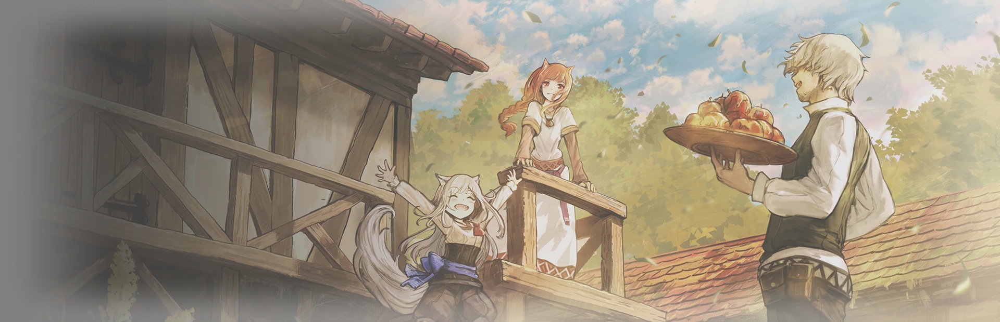

# dsh-theme-holo

> 《狼与香辛料》赫萝主题 —— 给 DeepSeek Harness Web GUI 的一层暖纸皮肤。

羊皮纸底色、麦金强调色、一段 12 秒实时渲染的开场动画、趴在输入框边偷看的她、
一张画像式的账户小卡、一枚可以自己摆位置的「狼与香辛料」字标，
以及只在你开始页亮着的右栏待机画面。


---

## 目录

- [这是什么](#这是什么)
- [功能一览](#功能一览)
- [安装](#安装)
- [功能详解](#功能详解)
  - [两套配色](#两套配色)
  - [开场动画](#开场动画12-秒实时渲染)
  - [浮动字标](#浮动字标)
  - [偷看的她](#偷看的她)
  - [动态档案卡](#动态档案卡)
  - [日志标签](#日志标签)
  - [侧栏脚下的麦田](#侧栏脚下的麦田)
  - [插件详情页横幅](#插件详情页横幅)
  - [右栏待机画面](#右栏待机画面)
  - [小鲸鱼挂件联动](#小鲸鱼挂件联动)
- [插件设置项](#插件设置项)
- [目录结构与素材](#目录结构与素材)
- [常见问题](#常见问题)
- [实现要点](#实现要点)
- [已知边界](#已知边界)
- [许可证与版权](#许可证与版权)

---

## 这是什么

一个 DeepSeek Harness 主题插件。装上之后，Harness 的 Web GUI 会从出厂的中性灰变成暖纸色，
并且多出若干装饰性组件——它们全部可以单独关掉。

| 项 | 说明 |
|---|---|
| 形态 | 正规 DSH 插件：`index.js`（宿主半）+ `client.js`（浏览器半）+ `assets/` + `素材/` + `cordis.patch.yml` |
| 浏览器半体积 | 约 182 KB，**不内联任何图片或音频**，只记 URL |
| 素材 | `assets/` 9 件 + `素材/` 9 件（本地另有 24 件设计稿，不进仓库），由宿主侧的 HTTP 路由送出 |
| 配色 | 浅色「麦秋晨光」与深色「星夜麦田」，110 个别名 token 各一套 |
| 依赖 | Node ≥ 22；无第三方运行时依赖 |

设计上有两条原则：

1. **不改宿主布局。** 所有装饰要么是挂在 `<body>` 上的独立浮动层，要么是纯 CSS 规则，
   不改宿主的 flex 盒、尺寸与 `overflow`。
2. **全部可关。** 每个组件在插件设置里都有开关，关掉即彻底移除，不留残余节点。

---

## 功能一览

| 功能 | 一句话 |
|---|---|
| **两套配色** | 浅色羊皮纸 / 深色暖墨，110 个别名 token 各一套 |
| **开场动画** | 12 秒 canvas 实时绘制：暗里的红眼 → 狼影描红 → 光炸开 → 标题解码 → 就绪 |
| **浮动字标** | 「狼与香辛料」字标，位置 / 大小 / 不透明度可调，可整个关掉 |
| **偷看的她** | 输入框边只露兜帽和一双眼，指针靠近会升起；可左右拖动 |
| **探头语音** | 点她会「疑惑」一声（可关） |
| **动态档案卡** | 悬停左下账户行，升起一张 Steam 式小卡 |
| **日志标签** | 「思考 / 读取 / 运行命令」等行内标签各一档暖色 |
| **侧栏麦田** | 侧栏脚下的一片麦穗，宽度跟着侧栏走，高度锚在账号行 |
| **插件详情页横幅** | 插件管理器里点进本插件时，内容顶部一张 1920×620 的封面 |
| **右栏待机画面** | 只在右栏自己的开始页亮的一段动画，六片可换，一进去干活就熄 |
| **小鲸鱼联动** | 一键把两个角色 + 一条语音装进 `dsh-whale-widget` |

---

## 安装

### 前置

- DeepSeek Harness 已安装并能正常打开 Web GUI
- 本仓库已下载到本地任意目录（下称 `<插件目录>`）

### 方式：本地目录 + `link:` 依赖

**第 1 步**，打开 profile 的 `package.json`：

```
%USERPROFILE%\.dsh\profiles\desktop\package.json
```

加入两处（其余内容保持不动）：

```jsonc
{
  "dependencies": {
    "dsh-theme-holo": "link:A:/你的路径/dsh-theme-holo"
  },
  "dsh": {
    "profile": {
      "bundles": [
        "dsh-theme-holo"
      ]
    }
  }
}
```

> `link:` 后面用**正斜杠**，路径里不要有空格；Windows 盘符写法是 `link:A:/...`。

**第 2 步**，在 profile 的 `node_modules` 下建一个目录链接（管理员 PowerShell 或 cmd）：

```cmd
mklink /J "%USERPROFILE%\.dsh\profiles\desktop\node_modules\dsh-theme-holo" "<插件目录>"
```

**第 3 步**，重启 DSH。

装好后打开界面：开场动画播完、页面加载完成，如果检测到小鲸鱼挂件，会弹一次
「要不要把赫萝装进挂件」的对话框（见[小鲸鱼挂件联动](#小鲸鱼挂件联动)）。不想装就选「暂不安装」，
之后不再弹。

### 卸载

删掉上面加的两行（`dependencies` 一行、`bundles` 一行），重启即可。

插件所有效果都挂在自己的 fiber 上：样式表、片头层、偷看层、档案卡、浮动字标、
麦田、待机画面、日志标签属性，都会随 fiber 一起移除，不会在页面上留下任何东西。

目录本身和 junction 可以留着（下次启用只需把两行加回来），也可以一并删掉。

---

## 功能详解

### 两套配色

浅色「麦秋晨光」与深色「星夜麦田」，**110 个别名 token 各给一套值**，键一一对应。

- 浅色规则挂在 `html body:not([data-ds-dark-theme])` 下；
- 深色规则挂在 `html body[data-ds-dark-theme]` 下。

两套值分别在 `client.js` 顶部的 `PALETTE` 与 `PALETTE_DARK` 两张表里，由同一个循环展开成 CSS 变量。
**两张表的键名与顺序必须完全一致**，改了一个就要改另一个。

**黑夜模式开关**走的是主题服务的 `setTheme('dark' | 'light')`，和「设置 → 外观」用的是同一个
偏好字段，所以两处是同一个状态，不会出现「设置里是深色、插件里写着浅色」的分裂。
宿主没有 theme 服务时回退为直接切 `body[data-ds-dark-theme]`。**默认关闭**：装好就是浅色，
不动你已有的外观偏好。

**深色下暖色装饰整体收起**：麦穗纹、飘落的麦粒、偷看的她、连接线这些按浅色羊皮纸调的装饰，
压到深色上会脏，所以用一条规则统一隐藏，只留深色外壳与星夜麦田的 token 值。
浮动字标与联动弹窗不在其列——字标是品牌标识，两套配色下都该在。

### 开场动画（12 秒，实时渲染）

不是视频，是 canvas 2D 逐帧绘制，用 `requestAnimationFrame` 按真实时间推进。
画布固定 1920×1080，帧率 30 fps，总时长 12 秒。

时间轴：

| 秒 | 画面 |
|---|---|
| 0.8 | 全黑，闭着的眼睑先透出红光 |
| 1.15 – 1.95 | 缓缓睁眼（先半睁，再完全睁开） |
| 2.45 / 2.92 | 两次眨眼，每次 0.2 秒 |
| 3.25 – 3.6 | 视线移向左边的狼影 |
| 3.4 – 6.1 | 镜头在黑暗中后拉 |
| 3.75 – 5.15 | 狼影轮廓被红光从背脊描到吻部 |
| 4.85 | 狼影的眼睛亮起 |
| 5.2 – 7.0 | 狼嚎 |
| 6.35 | 她眨一只眼 |
| 6.55 – 7.95 | 光从双眸炸开，照亮整张画 |
| 7.9 / 8.45 | `DEEPSEEK` 逐字解码出现，`HARNESS` 字距收拢 |
| 8.55 – 9.25 | 拉出一根「缰绳」，线头一颗红点 |
| 9.05 – 9.85 | 三行启动日志逐字打出 |
| 9.9 – 10.45 | 进度条走满 |
| 10.5 / 10.75 | 就绪闪光、标语 |
| 11.3 – 12 | 只淡出声音，画面停住 |

**操作**

- **任意点击 / 按键立刻结束**，0.55 秒淡出后交还屏幕。
- 右下角有 `跳过动画` 按钮，效果等同于点画面任意处。
- 系统开了「减少动态效果」（`prefers-reduced-motion: reduce`）时直接停在收尾帧。
- **音轨默认关闭**，右下角开关是 `♪ 音效 开` / `♪ 音效 关`。打开后会立刻播放并**自动对齐当前画面时间**，
  选择记在本地，下次启动沿用。点开关**不会**跳过片头。
- 插件设置里可以永久关闭开场动画（见[插件设置项](#插件设置项)）。关掉后连 canvas 都不创建，
  下一帧就把屏幕交回。

**调试入口**（写在 URL 里）

- `#boot-hold` 把片头停在关键帧；`#boot-hold=11.4` 可指定任意秒数，缺省停在 10.2 秒。
- `#videocap` 停在片头供录屏，`#videocap=tail` 额外多留 5 秒画面。

### 浮动字标

「狼与香辛料」字标（`assets/logo.png`，591×125 透明 PNG）是一块**自己定位的图**：
`position: fixed` + 视口百分比，挂在 `<body>` 上，位置和大小由插件说了算。

**为什么不做成标题栏里的水印**：尺寸和位置会被宿主的 flex 盒、容器单位与 `overflow` 规则牵着走，
插件改不动；而且一开插件设置页（宿主会换掉主面板），整棵会话连同标题栏被卸载，水印得靠常驻观察器
才能回来。挂在 `<body>` 上这两个问题都不存在。

**位置以视口百分比存储**（`xPct` / `yPct` / `wPct`），渲染时用 `vw` / `vh` 单位，
所以窗口缩放、最大化、换分辨率都不需要监听 `resize`，字标自动等比跟随。

**日常不拦点击**：图层常驻 `pointer-events: none`、`aria-hidden="true"`，不挂任何监听。
只有打开「更改 logo 位置」时才变成 `pointer-events: auto`，那时才能拖动。

**调位置、调大小**

1. 插件设置里点「更改 logo 位置」，字标出现一圈细线框、右下角小方块和实时坐标读数；
2. 拖图片移动，拖右下角小方块改大小，读数会实时显示 `x, y · 高 Npx`；
3. 按 `Esc` 也能退出；点「完成调整（固定下来）」把位置写进本地存储。

同一节里还有：

- **关闭 logo**：整个图层收掉（不是把不透明度降到 0——隐藏的东西不该还能接点击）。
  位置和大小原样保留，再点「显示 logo」就回到刚才停的地方。
- **恢复默认位置**：位置、大小、不透明度、显隐四项一起回到出厂值。

**不透明度**：10%–100% 的滑块，出厂 50%，拖动即时生效、松手即存。
下限是 10% 而不是 0：一个几乎透明的字标等于一件找不回来的东西。

**图层高度**：`z-index: 2`。这个数字是调出来的——`-1` 会被宿主的 `.BynINW_frame`
（不透明背景）整个吞掉；`0` / `auto` 会和它同趟按文档序绘制，而插件在宿主渲染外框之前就挂载了，
反过来被盖住。`2` 压得过外框，但低于宿主自己浮起来的控件（缩放手柄、overlay 层等）。
编辑态会升到很高的 z-index 并开启 `pointer-events`。

> 代价是它**会压在别的东西上**——它本来就在 GUI 之上。这是有意的取舍：字标是一块可以挪的图，
> 不是垫在纸下面的水印。想让它让开就把图拖走，或者在设置里「关闭 logo」。

### 偷看的她

输入框边上只露兜帽和一双眼，指针靠近会升起。所有动作由一个状态机驱动：
**露出多少、倾角、让位、点头**四个量，行为只写目标值，循环以 0.14 的系数缓动过去，
所以永远不会「跳」。

| 状态 | 触发 | 表现 |
|---|---|---|
| 常态 | 无输入 | 露出 32%，只到眼睛；整体再下沉 10px，底边被输入框卡片裁掉 |
| 正在打字 | 输入框有内容 | 露出 58%，朝文字倾，并从她手边拉出一根金线接到输入框 |
| 生成中 | 出现「停止」按钮 | 露出 62%，朝文字方向倾，盯着看 |
| 长文看累 | 输入 > 420 字 | 沉下去、透明度降到 55%，歪头表示嫌弃 |
| 打瞌睡 | 空闲 170 秒（23:00–05:00 为 75 秒） | 只留帽檐，鼠标一动就醒 |
| 打开菜单 / 弹窗 | 有 `[role=menu/dialog/listbox]` 或 `aria-modal` | 往右让开自身宽度的 55% 并透明到 0 |
| 靠近 | 指针在 96px 内但没落在她身上 | 往下缩 5px、歪头 |
| 指针移动 | 以她自己的中心算方向 | 整颗头朝指针倾斜，位移上限 ±10px / ±3px，倾角上限 ±2.2° |
| 点击她 | 点 | 纵向压扁一下 + 6 粒金麦从卡片后面飘起，并播一句应答语音 |
| 悬停 5 秒 | 一直指着她 | 一枚小苹果从帽檐后滚出来（纯 CSS 画） |
| 发送 | 点发送或回车 | 往下点一下头（320ms） |

麦粒和苹果都是临时节点，动画结束即移除；金线是 SVG 路径，只在「打字且没有弹窗」时出现。
「减少动态效果」时所有缓动系数置 1，麦粒和苹果直接不出现。

**她可以左右拖**：位置是**输入框宽度的分数**（不是像素），默认 `0.72`。
位移不到 4px 不算拖动，照常当成「点她」；拖过了就把这次抬手产生的 click 吃掉，不会误触发语音。
位置夹在她的中心可达范围内，插图不会跑到输入框两端之外。

**点她会说话**：`assets/peek-voice.wav`（「赫萝疑惑」）复用同一个 `Audio` 元素，
每次点击先 `pause()` 再把 `currentTime` 归零，所以连点不会互相打断、也不会叠音轨。
浏览器不给自动播放权限时静默失败——视觉反馈照常，不弹错。

**关掉她**：插件设置里的「探头的赫萝」开关，关掉后彻底不显示。语音可以单独关：
「探头的她说话」关掉后，点她只有动作，没有声音。

### 动态档案卡

悬停左下角账户行时升起，指针离开 **180ms** 后收起。卡片是纯 DOM + inline style，
**不是** `[role=dialog]`，所以不抢焦点、不锁指针；账户菜单本身完全不动。

结构是横幅图（`intro.jpg` 裁切放大）+ 渐变压暗 + 骑在横幅下沿的圆形头像（`avatar.jpg`）
+ 名字与一行小字。名字取自被悬停那一行的文本，所以换账户会跟着变。

只有侧栏内部滚动会让它收起——消息列表在生成时滚动极频繁，跟着收会让卡片闪一下就没了。

### 日志标签

「思考 / 读取 / 运行命令…」是 Harness 自己的行内标签，类名是哈希过的、所有类型共用一套，
没有 CSS 能直接区分它们。插件里加了一个很轻的观察器：

- 监听 body 的 childList（防抖 180ms），只扫 `span[class*="_title_"]`
- 文本以那几个词开头（长度 ≤ 8）时打上 `data-holo-kind="think|read|run|tool|write"`
- 样式全部挂在 `[data-holo-kind]` 上，卸载时把属性一起清掉

对应关系：思考→think；读取 / 图片 / 搜索→read；运行命令→run；工具调用→tool；写入 / 编辑→write。
开销可以忽略：一轮对话里这些 span 不过几十个，打过标记的不会重复处理。

### 侧栏脚下的麦田

`assets/wheat.png` 贴在左边栏最下面。它是一个挂在 `<body>` 上的**独立浮动层**
（`position: fixed`、`pointer-events: none`），只做一件事：测量侧栏列的矩形，
把 `left` / `width` / `bottom` / `height` 写成视口像素。
**不往宿主元素里插任何节点，也不改宿主元素的任何样式。**

| 项目 | 默认 | 说明 |
|---|---|---|
| 整体不透明度 | `.75` | `#holo-wheat` 的 `opacity` |
| 两侧淡出到 | `.4`（叠 75% 后为 30%） | 横向 `mask-image` |
| 上边缘淡出到 | `.4`（同上，30%） | `#holo-wheat i` 的纵向 `mask-image` |
| 高度 | 侧栏底部 → 账号行垂直中线 | `createWheatLayer()` 的 `place()` |

**边缘的 30% 不是一个独立的数**：两层是相乘关系，`0.75 × 0.4 = 0.30`。所以改整体浓度只动
`opacity` 一行，边缘会按比例跟着走。

**宽度跟侧栏、高度不变形**：图是 `background-repeat: repeat-x` + `background-size: auto 100%`，
宽度由 JS 写成侧栏列的像素宽，高度单独写成固定像素，所以侧栏变宽只是多铺几段，麦秆不会被拉胖。
图本身是 `素材/小麦.png`（452×146）左右**镜像拼接**成 904×146 的无缝片——原图左右缘 alpha
不一致，直接平铺会有一道断口。

高度锚在「账号菜单」行的垂直中线；找不到这行时退回列高的 18%，并夹在 `[24px, 列高]` 之间防呆。
窗口缩放、侧栏折叠、会话列表把账号行挤走，都由 `ResizeObserver` 重算，不轮询。

> 它压在宿主的 `.BynINW_frame` 之上，所以跨过名字那条带会有少量穗尖。
> 靠素材本身消化——`wheat.png` 顶部 0–20% 有 93.8% 完全透明，遮罩又降到 40%，几乎看不出；
> `pointer-events: none` 保证账号行仍可点。

### 插件详情页横幅

插件管理器里点进「赫萝主题」的详情页，内容顶部会有一张 1920×620 的横幅（`assets/cover.webp`）。

它是**正常文档流里的一个块**，不是浮动层，用 `::before` 伪元素实现——那页不归本插件所有，
伪元素不占位、不与标题图标打架、也不用往宿主的 DOM 里塞东西。
选择器用的是插件管理器自己打的 `[data-plugin-detail="dsh-theme-holo"]` 属性，
名字里没有哈希，宿主重建样式表也不会失效。

`cover.webp` 是**已经烘好浓度的版本**——75% 的整体场与 50% 的边缘淡出烤进了 WebP 的 alpha 通道。
CSS `opacity` 会把整个元素（含边框）一起淡掉，而背景图自身没有透明度旋钮，所以这一步在导出时做完。
要调浓淡就重新导出这张图；未压缩原件 `素材/横板封面.jpg` 留在作者本地备查（未随仓库发布）。

### 右栏待机画面

一段只在**右栏自己的开始页**亮着的动画。右栏里一开文件、终端或浏览器，开始页就被替换掉，
整层立刻撤掉——连 `<video>` 都从文档里摘掉、`src` 也丢掉，解码器随之释放。
这是刻意的：待机画面是气氛，不该在干活的时候压在栏底下耗显存。

| 项 | 做法 |
|---|---|
| 容器 | `#holo-scene`（`position: fixed; inset: 0; z-index: -1; pointer-events: none`），由 `html[data-holo-scene="on"]` 打开 |
| 切片 | 宽度取 `min(右栏宽, 608px)`，左边缘对齐画面，`overflow: hidden` 负责裁 |
| 视频 | 固定 **608×1080** 的盒子，**1:1 不缩放**。素材本身就是 608×1080 的竖裁，所以画面里的她是真实尺寸 |
| 渐隐 | 视频顶部 58% 不透明、78% 降到 55%、底部到全透明 |
| 左右边缘 | 各 10% 区域做模糊 + 透明度淡到 50%，中间保持清晰 |
| 深色 | 底色渐变 `#14100B → #100D09`，视频 `opacity: .94`，另叠 scrim 与 veil 两层压暗 |
| 浅色 | 底色渐变 `#FBF7EF → #F6EEDF`，视频 `opacity: .82` + 暖色滤镜 + `mix-blend-mode: multiply`——不是加一层暖色，而是把它**印进纸里** |

**为什么必须清掉宿主的底色**：视频垫在 `z-index: -1`，比宿主外框和右栏自己的不透明背景都要靠后，
不清就是「什么都没发生」。所以亮着的时候，插件会给**内联**加 `background-color: transparent`
并打上标记：右栏面板、栏里每个铺满的大盒子、以及列的祖先链（到 `body` 为止）。
收盘面时把那些内联值 `removeProperty` 掉。**只碰这条已知的祖先链和栏里的大盒子，不做全文档扫描**
——扫一遍会把界面扒光。判断「大盒子」用的是面积阈值（宽 ≥ 栏宽 85%、高 ≥ 栏高 50%），
所以开始页那几个入口胶囊不会被动。

**开始页怎么认**：不认哈希类名，认宿主自己写的三个 `data` 属性——
`[data-sidebar-right-panel]`（栏本身）、`[data-sidebar-right-open]`（展开态）、
`[data-sidebar-right-guide]`（栏自己的开始页）。三个条件同时满足才亮。
一个会话一份面板，被搁置的会话节点还留在文档里，所以查面板和开始页都只在**可见的那一个**里找。

**六段可换，名称就是文件名**。`素材/动画/` 下六个 `.webm` 对应设置页里的六个选项：

| 选项名 | 文件 |
|---|---|
| 赫萝抱臂 | `素材/动画/赫萝抱臂.webm` |
| 赫萝开心（默认） | `素材/动画/赫萝开心.webm` |
| 缪莉开心1 | `素材/动画/缪莉开心1.webm` |
| 缪莉开心2 | `素材/动画/缪莉开心2.webm` |
| 赫萝叉腰 | `素材/动画/赫萝叉腰.webm` |
| 缪莉挥手 | `素材/动画/缪莉挥手.webm` |

选项名与文件名严格一致，**换片只要同名覆盖文件，不用改一行代码**。

**它看起来糊，通常不是它自己的问题**。素材是 608×1080 的竖裁，按 1:1 显示，**没有上采样**。
真正把画面变糊的是**装了 wallpaper 插件（`dsh-plugin-wallpaper-engine`）并开着液态玻璃 /
磨砂效果**：那一层用 `backdrop-filter: blur()` 把背后的一切——包括这段待机动画——一起雾化。
本插件对视频只写 `opacity`、`object-fit`、`mask-image`、色相滤镜与 `mix-blend-mode`，
**没有任何 `blur()`**。

判断方法：把 wallpaper 插件的雾化强度**调低**（或直接关掉液态玻璃）再看这一栏，糊度随之下降
即为其所致。想让画面清楚又保留玻璃质感，把雾化调到最低档通常就够了。

> 注意别和「小鲸鱼挂件」（`dsh-whale-widget`）搞混：那是角色与语音的挂件，不碰背景滤镜。
> 这里说的雾化只来自 wallpaper 插件。

### 小鲸鱼挂件联动

装了小鲸鱼挂件（`dsh-whale-widget`）的人，可以不动手多出两个可替换角色和一条语音。

| 装进挂件的名字 | 来源文件 | 类型 |
|---|---|---|
| 赫萝 | `素材/holo-clean.png` | 角色 |
| 赫萝Q版 | `素材/holo-Q-clean.png` | 角色 |
| 赫萝震惊 | `素材/赫萝语音.WAV` | 音效组（按下音） |

**什么时候问**：片头播完、页面加载完之后，前端先探一次挂件的 `/dsh-whale/roles.json`：

- 挂件没装 → 路由不存在，`fetch` 失败，安静跳过，什么都不弹；
- 挂件装了、且三个名字里缺任何一个 → 弹一次羊皮纸对话框，说明会装什么，
  给「立即安装」和「暂不安装」两个选择；
- 已经齐了 → 不弹。

「问过了」这件事记在本地，无论选了哪个都记下来，**所以只弹一次**。

**之后想补装**：插件页（插件 → 已安装 → 赫萝主题）的包详情页里有一块「赫萝 × 小鲸鱼挂件」，
常驻显示当前状态，缺什么就列出什么，按钮「一键导入联动内容」。

| 状态 | 显示 |
|---|---|
| 没装挂件 | 「没有检测到小鲸鱼挂件。」，按钮不可用 |
| 检查中 | 「正在检查小鲸鱼挂件…」 |
| 缺内容 | 「还缺：角色 X；语音片段；音效组。」，按钮「一键导入联动内容」 |
| 齐了 | 「已写入小鲸鱼挂件的数据目录：角色「赫萝」「赫萝Q版」，语音组「赫萝震惊」。」 |

导入成功后还会多出一个「刷新页面」按钮——**小鲸鱼挂件只在页面加载时读一次角色列表**，
导入后要点「刷新页面」（或按 Ctrl+R）才会在它的「角色」里出现。不给这个按钮，
导入看起来就像失败了。

**装的时候做了什么**：对每个缺的角色，`fetch` 一次 `/holo-theme/link/<文件名>` 拿到字节 →
转成 `data:` URL → `POST /dsh-whale/roles.json`；语音同理，先上传片段拿回 `id`，
再用 `save-group` 建音效组。**按名字比对，已有的不动**，所以重复点是安全的。

> 挂件的路由受宿主鉴权保护，所以联动只在浏览器里跑得通，命令行侧没法代劳。
> 这也意味着**必须重启一次 Harness**，新的 `/holo-theme/link/` 路由才会存在。

---

## 插件设置项

插件页（插件 → 已安装 → `dsh-theme-holo`）的包详情页里，卡片最上面是联动区块，
下面依次是六组开关。组件行页也有同一块。

| 小节 | 控件 | 存哪 |
|---|---|---|
| 开场动画 | `关闭开场动画` / `开启开场动画` | `localStorage['dsh-theme-holo.skip-boot']` |
| 探头的赫萝 | `不启用探头的赫萝` / `启用探头的赫萝` | `localStorage['dsh-theme-holo.peek-off']` |
| 探头的她说话 | `关闭探头语音` / `开启探头语音` | `localStorage['dsh-theme-holo.peek-voice-off']` |
| 黑夜模式 | `开启黑夜模式` / `关闭黑夜模式` | 主题服务的 `preference` 字段（同「设置 → 外观」） |
| 右侧待机动画 | 下拉框，六个选项就是六个文件名 | `localStorage['dsh-theme-holo.scene-name']` |
| 更改 logo 位置 | `更改 logo 位置` / `完成调整`，另有 `关闭 logo` / `显示 logo`、`恢复默认位置`，以及一条 10%–100% 的不透明度滑块 | `localStorage['dsh-theme-holo.logo-place']` |

各开关的状态行文案：

- **开场动画**——关：「已关闭：启动时直接进入界面。」；开：「已开启：每次启动播放约 12 秒。」
- **探头的赫萝**——关：「已关闭：输入框边上不再出现探头。」；开：「已开启：鼠标移到输入框边上时她会探出头来。」
- **探头的她说话**——关：「已关闭：点她只有动作，没有声音。」；开：「已开启：点她会「疑惑」一声。」
- **黑夜模式**——开：「已开启：界面使用「星夜麦田」深色配色。」；关：「已关闭：界面使用「麦秋晨光」浅色配色。」
- **右侧待机动画**——「当前：赫萝开心（默认）。只在右侧栏的开始页显示；左右边缘渐变到 50% 不透明度。」
- **更改 logo 位置**——编辑中显示实时坐标；关闭时「已关闭：logo 停在原处，不会挡住任何点击。」

---

## 目录结构与素材

```
dsh-theme-holo/
├── index.js            宿主半：注册三条只读文件路由
├── client.js           浏览器半：配色、组件与全部交互
├── cordis.patch.yml    bundle 补丁：向 profile 插入一行宿主行
├── package.json        清单（dsh.bundle / dsh.client / icon）
├── locale/             zh.json、en.json —— 插件列表里的标题与描述
├── assets/             主题自己渲染的 9 件素材
└── 素材/               源料与联动画材（9 件运行时需要，其余是设计稿，不进仓库）
```

### `assets/` —— 主题自己渲染的图

| 文件 | 字节 | 尺寸 | 用途 |
|---|---:|---:|---|
| `avatar.jpg` | 11,700 | 160×160 | 档案卡的圆形头像 |
| `intro.jpg` | 85,210 | 1920×1080 | 片头底图，也是档案卡的横幅源 |
| `intro.mp3` | 241,004 | — | 片头音轨（12 秒） |
| `peek.png` | 316,083 | 575×560 | 偷看的她：兜帽抱面包，已抠成透明 |
| `peek-voice.wav` | 130,090 | — | 点她时的应答语音 |
| `logo.png` | 45,916 | 591×125 | 浮动字标，已裁掉透明留白 |
| `icon.jpg` | 4,516 | 64×64 | 插件列表图标。**不经过 HTTP 路由**，由 DSH 从清单 `icon` 字段读取 |
| `wheat.png` | 84,582 | 904×146 | 侧栏脚下的麦田，`素材/小麦.png` 镜像拼接成的无缝片 |
| `cover.webp` | 205,082 | 1920×620 | 插件详情页顶部的横幅 |

合计约 1.07 MB。改素材直接替换同名文件即可，**不需要任何构建步骤**。

### `素材/` —— 源料与联动画材

本地有 33 项，其中**九件是运行时真正要用的**（三件联动画材 + 六段待机动画），会随仓库发布；
其余是修图原件与设计稿，代码里没有任何引用，已写进 `.gitignore`，**只留在本地**。

| 文件 | 字节 | 说明 | 进仓库 |
|---|---:|:---|:---:|
| `holo-clean.png` | 261,743 | **联动画材**：角色「赫萝」，474×391，去白边后的立绘 | 是 |
| `holo-Q-clean.png` | 148,496 | **联动画材**：角色「赫萝Q版」，351×318 | 是 |
| `赫萝语音.WAV` | 147,534 | **联动画材**：音效组「赫萝震惊」的按下音 | 是 |
| `动画/` | 6 个 | **待机动画**，各 608×1080 VP9，文件名就是设置页里的选项名 | 是 |
| `holo.png` / `holo-Q.png` | 338,439 / 147,737 | 未修白边的原件，已被上面两张 `*-clean` 取代 | 否 |
| `赫萝疑惑.wav` | 130,090 | 探头语音源文件，成品是 `assets/peek-voice.wav` | 否 |
| `logo.png` | 48,844 | 字标原件（640×360，含留白），成品是 `assets/logo.png` | 否 |
| `图标.jpg` | 4,516 | 插件图标原件 | 否 |
| `小麦.png` | 43,064 | 麦穗纹原件（452×146），成品是 `assets/wheat.png` | 否 |
| `横板封面.jpg` | 368,791 | 横版封面设计稿，成品是 `assets/cover.webp` | 否 |
| `竖版封面.png` | 835,044 | 竖版封面设计稿 | 否 |
| `文字/` | 8 个 | 「狼与香辛料」拆字，纯白字面 + 透明背景 | 否 |
| `文字浮雕/` | 8 个 | 上面八个字的浮雕版 | 否 |

`文字/` 与 `文字浮雕/` 目前没有被 `client.js` 引用，是备用的装饰素材。

想让这些源料也进仓库，把 `.gitignore` 末尾「非运行时文件」那一段删掉即可。

### 素材是怎么送出去的

宿主半 `index.js` 在 `webServer` 上注册**三条前缀路由**：

```
GET/HEAD  /holo-theme/assets/<file>   →  assets/
GET/HEAD  /holo-theme/link/<file>     →  素材/
GET/HEAD  /holo-theme/anime/<file>    →  素材/动画/
```

**每条路由都只送白名单里点名的文件**，不是「目录里有什么就送什么」：

- `index.js` 顶部的 `ALLOW` 是一张 `路由前缀 → 确切文件名集合` 的表，共 18 项。
  请求路径规范化后算出相对路径，不在集合里一律 `404`——即使文件确实在磁盘上。
- 为什么要这样：`素材/` 是加工现场，混着未修白边的原件、封面草稿和 24 张字形切图。
  整目录放行等于把这些全部挂到页面上，谁都能直接下载。白名单同时挡住「以后往素材目录里
  随手丢个文件，它悄悄变成公开可访问」。
- 子目录不可达（`素材/文字/…` 一律 404），路径穿越在规范化之后判定，越界同样 404。

其余行为：

- `Cache-Control: public, max-age=31536000, immutable` + 强 `ETag`（`if-none-match` 直接 304）
- 支持单区间 `Range`（含 `bytes=-N` 尾段形式），返回 `206` 与 `Content-Range`；越界返回 `416`
- 只接受 `GET` / `HEAD`，其余方法回 `405` 并带 `Allow`
- 带 `X-Content-Type-Options: nosniff`
- 路由随插件 fiber 一起注销，卸载后不留孤儿路由

浏览器半只记两个前缀常量，各 URL 由它拼出来。因为用的是**同源相对路径**，
无论 Web GUI 走 HTTP 还是 Electron 的自定义协议都能取到。

---

## 常见问题

**Q：装好了但完全没变化？**

检查三件事：① profile 的 `package.json` 里 `dependencies` 和 `bundles` 两处都加了吗；
② `node_modules\dsh-theme-holo` 这个 junction 建了吗、指向对不对；
③ 重启过 DSH 吗（浏览器半在启动时加载）。

**Q：右栏待机画面很糊？**

多半是 **wallpaper 插件（`dsh-plugin-wallpaper-engine`）**的液态玻璃 / 磨砂效果在雾化背景，
不是本插件的问题。把 wallpaper 插件的**雾化强度调低**（或关掉液态玻璃）再看这一栏，
糊度明显下降即为其所致。详见[右栏待机画面](#右栏待机画面)。

**Q：右栏待机画面不显示？**

它只在**右栏自己的开始页**亮。右栏里开了文件、终端或浏览器，开始页被替换，整层就会撤掉。
另外它需要右栏处于**展开**状态。

**Q：深色模式下麦穗、探头、麦粒都不见了？**

有意为之。这些装饰的配色是按浅色羊皮纸调的，压到深色上会脏，所以深色下整体收起。

**Q：字标挡住了按钮？**

它是一层浮在 GUI 之上的图，停在哪就盖住哪。把它拖走，或者在设置里「关闭 logo」。

**Q：小鲸鱼挂件里没出现「赫萝」？**

挂件只在页面加载时读一次角色列表。导入后点设置里的「刷新页面」按钮，或按 Ctrl+R。

**Q：改了 `client.js` 没生效？**

浏览器半在启动时加载，需要重启 DSH。

**Q：能从旧版本升级吗？**

可以，但**新增了 `/holo-theme/link/` 路由的版本必须重启一次**，联动才能取到画材。

---

## 实现要点

**为什么宿主半要注册路由。** `webServer` 是纯 `node:http` 路由表，本身不提供任何静态文件服务；
想让浏览器拿到包内文件，只能自己注册一条路由并自己写响应头。本插件按 `kind: 'prefix'` 注册，
并且注册在 SPA 兜底之前，所以素材请求不会被兜底吞成 HTML。

**为什么 `inject: ['webServer']` 是硬依赖。** 挂载时用 `ctx.get('webServer')` 去取是竞态的
（各行并发挂载），而漏注册的后果是每个素材请求都被 SPA 兜底回答成 index.html——
浏览器拿到一张 HTML 当图片用。

**失败策略。** 取不到 `document`、取不到 `webServer` 时安静退出，不抛错。
DSH 的插件加载是全有或全无的，为一条装饰性路由把整个客户端拖垮不值得。
每个浮动层的挂载也都包在 `try / catch` 里——某个装饰出问题不该带倒整层皮肤。

**单例模块 + 观察者同步。** 字标的位置存在模块级状态里，图层（DOM）与设置卡片（React）
是两个世界，通过一个极小的观察者集合保持同步：图层改动后通知，卡片订阅后重渲染。
这样拖拽时读数实时跟着变，在卡片里点「恢复默认」时图层也立刻回位。

**为什么字标层不用 React。** 设置卡片重渲染极频繁，字标若在 React 树里就会跟着 remount，
拖到一半中断。所以它是一段纯 DOM 节点，由 `ctx.effect` 负责挂到 `document.body` 上并在销毁时摘掉。

**DOM 触点**：九个自建根节点 + 一个 `<style>`，都随插件 fiber 卸载移除，并各自带 `dispose`。
其中 `<style>` 挂在 `head`，其余九个都是 `body` 的直接子节点：

| 触点 | 作用 |
|---|---|
| `#holo-boot` | 片头层 |
| `#holo-peek` | 偷看层 |
| `#holo-thread` | 金线层 |
| `#holo-peek-fx` | 麦粒 / 苹果特效层 |
| `#holo-profile-card` | 档案卡 |
| `.holo-link-overlay` | 联动弹窗 |
| `[data-holo-logo]` | 字标层 |
| `#holo-wheat` | 侧栏脚下麦田 |
| `#holo-scene` | 右栏待机画面 |
| `<style>` | 样式表 |

### 调参入口

| 想改什么 | 改哪里 |
|---|---|
| 浅色 / 深色颜色 | `client.js` 的 `PALETTE` / `PALETTE_DARK`（键必须一一对应） |
| 片头节奏 | `createIntroScene()` 的 `CUES` 表 |
| 片头时长 | 同处的 `DURATION` |
| 偷看档位 | `createPeeker()` 的 `SLEEP` / `REST` / `OPEN` / `FULL` / `SINK` |
| 打瞌睡时长 | `createPeeker()` 的 `dozeAfter` |
| 日志标签词表 | `createLogTags()` 的 `KINDS` 数组 |
| 字标出厂位置 / 大小 | `LOGO_DEFAULT` 的三个比例 |
| 字标尺寸上下限 | `LOGO_W_RANGE` |
| 字标不透明度上下限 | `LOGO_ALPHA_RANGE` |
| 麦田浓度 / 边缘淡出 | `#holo-wheat` 与 `#holo-wheat i` 两条规则 |
| 待机动画默认哪一片 | `SCENE_NAME_DEFAULT` |
| 待机动画选项与顺序 | `SCENE_NAMES` 与 `素材/动画/` 里的同名文件 |
| 联动画材 / 名字 | `LINK_ROLES`、`LINK_VOICE` |

---

## 已知边界

| 边界 | 说明 |
|---|---|
| 字标会压在别的东西上 | 它是浮在 GUI 之上的图，停在哪就盖住哪。想让它让开就拖走，或「关闭 logo」 |
| 字标可能被别的浮层压住 | 锁定态只是 `z-index: 2`，别的插件往上面盖浮层、或宿主自己弹的 popover 都会盖过它，属预期 |
| 窗口顶部的「应用 / 编辑」菜单 | 那是 Electron 的原生菜单栏（Windows 由系统绘制），不在页面 DOM 里，页面侧插件无法上色 |
| 深色下装饰不见了 | 有意为之 |
| 右栏待机画面只在右栏开始页 | 有意为之；它会临时清掉右栏面板与列的底色，收盘面时还原。宿主改 DOM 层级时这几处选择器要重新对齐 |
| 改 `client.js` 要重启 | 浏览器半在启动时加载 |
| 联动依赖挂件自身的接口 | 用的是 `dsh-whale-widget` 的 `/dsh-whale/roles.json` 与 `audio.json`，挂件改接口时这一处要跟着改 |
| 联动导入后要手动刷新 | 挂件每个页面加载只读一次角色列表，本插件只负责把按钮给出来 |
| 依赖 Harness 的类名 / 结构 | 偷看层依赖输入框卡片的位置测量；日志标签依赖 `span[class*="_title_"]`；档案卡依赖 `[aria-label="账号菜单"]`；麦田依赖侧栏列。Harness 大改版时这几处可能需要重新对齐 |
| 没有侧栏就没有麦田 | 窄布局会把侧栏整个收掉，此时不挂空节点、也不报错 |
| 新增素材要同时改白名单 | 路由只送 `index.js` 里 `ALLOW` 点名的文件。往 `assets/`、`素材/`、`素材/动画/` 里加了新文件却没加进 `ALLOW`，页面会 404 而不是自动生效 |
| 待机画面看着糊，多半是 wallpaper 插件的雾化 | 调低雾化强度即可缓解。见[右栏待机画面](#右栏待机画面)末段 |

---

## 许可证与版权

**作者**：[1015677515](https://github.com/1015677515)
**联合创始人**：[holoiallo](https://github.com/holoiallo)

**代码**以 [MIT](LICENSE) 许可发布。`LICENSE` 开头写明了适用范围：**MIT 只覆盖源代码**，
不覆盖 `assets/` 与 `素材/` 里的图像、动画与音频。

**关于《狼与香辛料》**：赫萝、缪莉等角色及「狼与香辛料 / Spice and Wolf」名称的著作权归
原作权利人（支倉凍砂 / ASCII Media Works 等）所有。本项目是非商业性的同人作品，
与权利人无任何关联，也未获其授权或背书。

**关于素材**：`assets/` 与 `素材/` 中的角色立绘、动画、语音**均来自网络**，是收集与二次加工
得到的同人素材，**并非本人原创**，来源与原作者已难以逐一追溯。这里仅作个人学习与自用，
**不主张任何权利**，也不构成对素材的授权。

若你要二次分发、公开再发布或商用，**请自行替换为你拥有权利的素材**——代码与素材是分开的，
替换素材不需要改任何代码。如果你是在原作权利人/原作者立场上认为某件素材不应出现在此处，
提出后我会立即移除。

苹果 emoji 来自 [Twemoji](https://github.com/twitter/twemoji)（CC-BY 4.0）。
